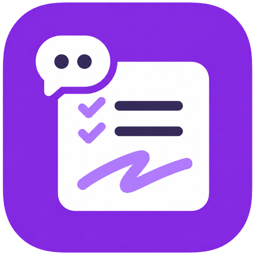
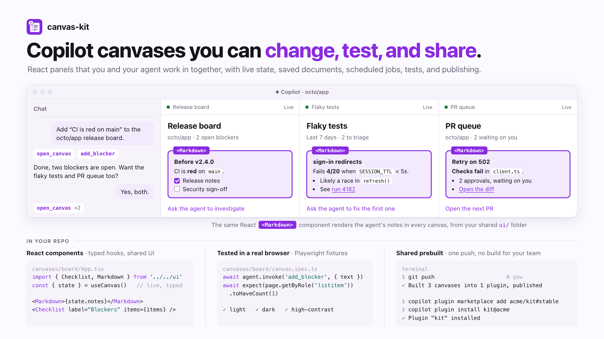
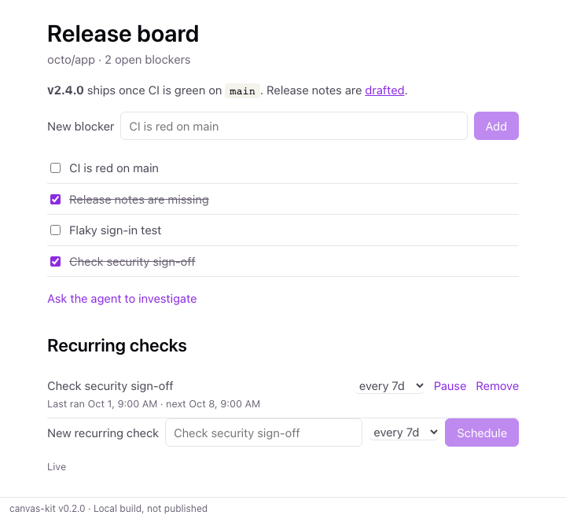
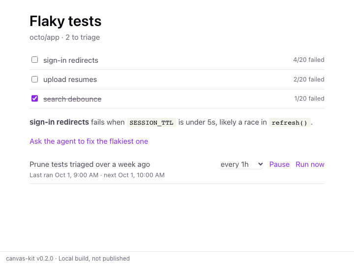
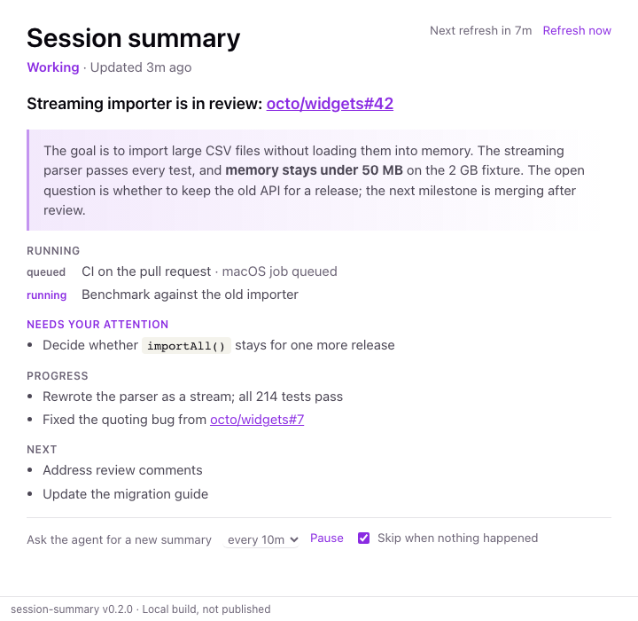

# canvas-kit

**Copilot canvases you can change, test, and share.** Build the release boards,
triage queues, and review tools that you and your agent work in together: state
and actions in TypeScript, UI in React, and canvas-kit handles the rest.


<picture>
  <source media="(prefers-color-scheme: dark)" srcset="docs/hero-dark.png">
  
</picture>

## What you get

- **React components.** Typed hooks wire your components to live state; share them
  across canvases to stay on brand.
- **Live, two-way canvases.** The agent's changes appear instantly, it reads yours,
  and a button can hand it the next task.
- **Saved, shared documents.** One board per repository: every chat on the release
  updates it, and tomorrow's chat picks up where today's left off.
- **Scheduled jobs.** Refresh pull request checks every 15 minutes or prune last
  week's triaged tests, even with no chat open. Users can pause or retime them.
- **A fast dev loop.** Preview changes live in your browser with no reinstalling,
  then test as the agent and the user with Playwright.
- **Share with one push.** `git push` publishes your canvases, skills, agents, and
  MCP servers for your users to install in two commands.

For a one-off view, plain HTML is fine. canvas-kit is for canvases you keep and
share.

## Try it

```sh
copilot plugin marketplace add rwoll/canvas-kit#stable
copilot plugin install canvas-kit@canvas-kit
```

The `canvas-kit` plugin has the release board and flaky tests example canvases,
and the skills for building your own. Reload extensions, start a new chat, and ask:

> Open the release board for octo/app and add a blocker: CI is red on main.

<table>
  <tr>
    <td>
      <picture>
        <source media="(prefers-color-scheme: dark)" srcset="docs/release-board-dark.png">
        
      </picture>
    </td>
    <td>
      <picture>
        <source media="(prefers-color-scheme: dark)" srcset="docs/flaky-tests-dark.png">
        
      </picture>
    </td>
  </tr>
</table>

For a long chat, install the Session summary on its own:

```sh
copilot plugin install session-summary@canvas-kit
```

> Open the session summary.

The agent writes an executive summary of the chat's work, and the canvas asks it
for a new one every 10 minutes. It skips a refresh when the agent has done nothing
since the last summary, so an idle chat costs no model turns.

<picture>
  <source media="(prefers-color-scheme: dark)" srcset="docs/session-summary-dark.png">
  
</picture>

## Build one

```sh
npm create @rwoll/canvas my-canvases -- --repository you/my-canvases --canvas release-board
cd my-canvases
pnpm install
pnpm dev                             # every canvas in your browser, live
```

It is one project. Each canvas is a folder in `canvases/`, and the project has one
`package.json`, `vite.config.ts`, and `tsconfig.json`:

```text
canvases/release-board/
  canvas.ts         state and actions
  App.tsx           its React UI
  canvas.test.ts    unit tests (Vitest)
  canvas.spec.ts    browser tests (Playwright)
ui/                 components and a theme every canvas shares
skills/             skills that ship with the canvases
```

`canvas.ts` holds the state and actions:

```ts
import { defineCanvas, z } from '@rwoll/canvas-kit'

export default defineCanvas({
  id: 'you-release-board',
  title: 'Release board',
  description: 'Track release blockers for a repository with the agent.',
  input: z.object({ repo: z.string() }),
  state: z.object({ repo: z.string(), blockers: z.array(z.string()) }),
  init: ({ input }) => ({ repo: input.repo, blockers: [] }),
  persist: { key: ({ input }) => input.repo },   // one saved board per repository
  actions: ({ action }) => ({
    // The agent calls it as a tool; the UI calls it as a typed function.
    add_blocker: action({
      description: 'Add a release blocker.',
      input: z.object({ text: z.string().min(1) }),
      run: (ctx, { text }) =>
        ctx.setState((s) => ({ ...s, blockers: [...s.blockers, text] })),
    }),
    // A button in the canvas that messages the agent.
    ask_agent: action({
      description: 'Ask the agent to investigate the blockers.',
      expose: 'ui',
      run: (ctx) =>
        ctx.sendToAgent({ prompt: `Investigate the blockers in ${ctx.state.repo}` }),
    }),
  }),
})
```

`App.tsx` is the UI, typed from that file:

```tsx
import { createCanvasHooks } from '@rwoll/canvas-kit/react'
import type canvas from './canvas.ts'

const { useCanvas, useAction } = createCanvasHooks<typeof canvas>()

export default function App() {
  const { state } = useCanvas()                  // updates live when the agent acts
  const [addBlocker] = useAction('add_blocker')
  const [askAgent] = useAction('ask_agent')
  return (
    <main>
      <h1>{state.repo}</h1>
      <ul>{state.blockers.map((text, i) => <li key={i}>{text}</li>)}</ul>
      <button onClick={() => addBlocker({ text: 'CI is red on main' })}>Add</button>
      <button onClick={() => askAgent()}>Ask the agent</button>
    </main>
  )
}
```

Add more canvases with `pnpm new-canvas <name>`. They all ship in one plugin, with
your skills, and run in one process per chat.

## Test it

```ts
// canvas.spec.ts: Playwright against the built canvas
import { canvasTest, expect } from '@rwoll/canvas-kit/playwright'
import canvas from './canvas.ts'

const test = canvasTest(canvas)

test('the user and the agent share the board', async ({ openCanvas, agent }) => {
  const { page } = await openCanvas({ repo: 'octo/app' })
  await page.getByRole('button', { name: 'Add' }).click()        // as the user
  await agent.invoke('add_blocker', { text: 'Docs missing' })    // as the agent
  await expect(page.getByRole('listitem')).toHaveCount(2)
  await page.getByRole('button', { name: 'Ask the agent' }).click()
  await expect.poll(() => agent.messages.length).toBe(1)         // it messaged the agent
})
```

```sh
pnpm check     # build, typecheck, unit tests
pnpm e2e       # Playwright in light, dark, and high contrast
```

## Share it

```sh
git push       # publishes your canvases and skills, prebuilt, to the stable branch
```

Your team installs them with no build step, and each canvas shows which build it
runs in a small footer:

```sh
copilot plugin marketplace add you/my-canvases#stable
copilot plugin install my-canvases@my-canvases
```

To let people install some canvases on their own, as this repository does with the
Session summary, list them as a separate plugin in `vite.config.ts`.

## Let Copilot build it

```sh
copilot plugin install canvas-kit@canvas-kit
```

> Build a canvas that lists this week's flaky tests and lets me mark them triaged.

The skills teach the agent to build, test, and publish canvases.

## Learn more

- [API guide](packages/canvas-kit/README.md): [defining a canvas](packages/canvas-kit/README.md#defining-a-canvas),
  [shared documents and jobs](packages/canvas-kit/README.md#shared-documents-and-scheduled-jobs),
  [React hooks](packages/canvas-kit/README.md#using-it-from-react),
  [components and theme](packages/canvas-kit/README.md#sharing-components-and-a-theme),
  [testing](packages/canvas-kit/README.md#testing), and
  [publishing](packages/canvas-kit/README.md#github-actions)
- [Example canvases](canvases) and the [shared `ui/` folder](ui) they use
- [Agent skills](skills) for building, testing, and publishing
- [Changelog](CHANGELOG.md)

This repository is itself a canvas-kit marketplace. See
[CONTRIBUTING.md](CONTRIBUTING.md) to work on it, [RELEASING.md](RELEASING.md) for
how releases are made and protected, and [SECURITY.md](SECURITY.md) to report a
vulnerability. MIT licensed.
