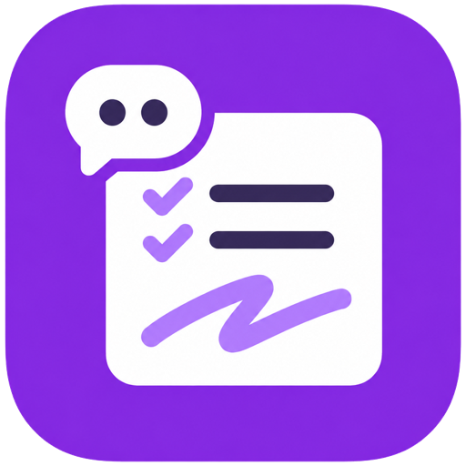
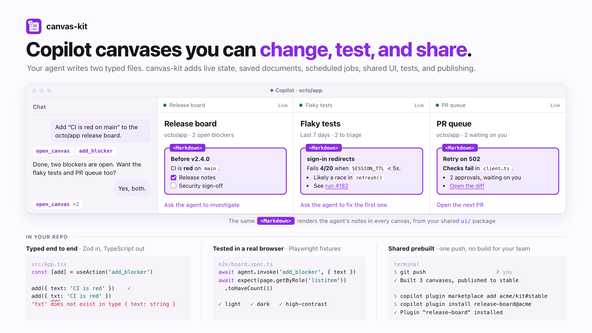
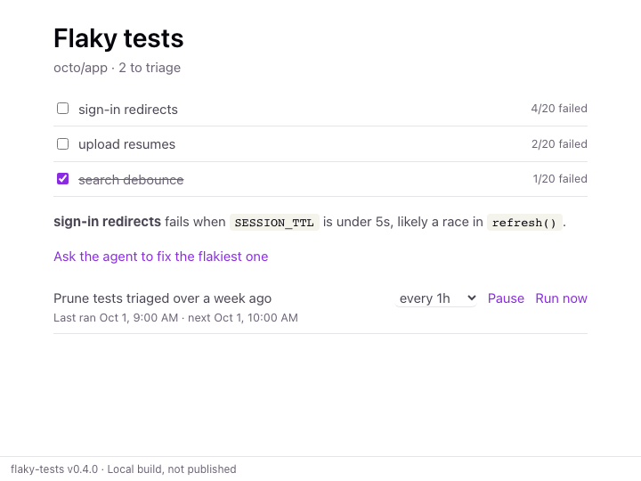

# canvas-kit

**Copilot canvases you can change, test, and share.** Describe a canvas once in
TypeScript: its state, and the actions that both the agent and the user call.
canvas-kit turns it into a live React panel in Copilot, and takes care of saved
state, scheduled jobs, tests, and publishing.


<picture>
  <source media="(prefers-color-scheme: dark)" srcset="docs/hero-dark.png">
  
</picture>

## What you get

- **One definition, typed end to end.** The agent gets your actions as tools, every
  call is validated, and the UI gets typed React hooks, all from one Zod schema.
- **Live, two-way canvases.** The agent and the user change the same state, and
  every open view updates at once. A button can also message the agent.
- **Saved documents, shared across chats.** Key a canvas by a repository or a file:
  every chat that opens it works on the same document, and it outlives the chat.
- **Scheduled jobs.** Keep documents up to date on an interval. Users and the agent
  can pause, retime, or add jobs, and they run from cron with no chat open.
- **Shared components and one theme.** A `ui/` package with Header, Checklist,
  Markdown, and your own components keeps every canvas consistent.
- **A dev server and real tests.** Preview a canvas in your browser with live
  actions, then test it with Playwright as both the agent and the user.
- **One-push publishing.** `git push` builds your canvases, plus any skills, agents,
  or MCP servers, into a plugin marketplace your team installs in two commands.

An agent can write a one-off canvas in plain HTML. canvas-kit is for the ones you
keep changing and share.

## Try it

```sh
copilot plugin marketplace add rwoll/canvas-kit#stable
copilot plugin install release-board@canvas-kit
copilot plugin install flaky-tests@canvas-kit
```

Reload extensions, start a new chat, and ask:

> Open the release board for octo/app and add a blocker: CI is red on main.

<table>
  <tr>
    <td>
      <picture>
        <source media="(prefers-color-scheme: dark)" srcset="docs/release-board-dark.png">
        
      </picture>
    </td>
    <td>
      <picture>
        <source media="(prefers-color-scheme: dark)" srcset="docs/flaky-tests-dark.png">
        
      </picture>
    </td>
  </tr>
</table>

## Build one

```sh
npm create @rwoll/canvas my-canvases -- --repository you/my-canvases --canvas release-board
cd my-canvases
pnpm install
pnpm --filter release-board dev      # the canvas in your browser, live
```

`server/canvas.ts` holds the state and actions:

```ts
import { defineCanvas, z } from '@rwoll/canvas-kit'

export default defineCanvas({
  id: 'you-release-board',
  title: 'Release board',
  description: 'Track release blockers for a repository with the agent.',
  input: z.object({ repo: z.string() }),
  state: z.object({ repo: z.string(), blockers: z.array(z.string()) }),
  init: ({ input }) => ({ repo: input.repo, blockers: [] }),
  persist: { key: ({ input }) => input.repo },   // one saved board per repository
  actions: ({ action }) => ({
    // The agent calls it as a tool; the UI calls it as a typed function.
    add_blocker: action({
      description: 'Add a release blocker.',
      input: z.object({ text: z.string().min(1) }),
      run: (ctx, { text }) =>
        ctx.setState((s) => ({ ...s, blockers: [...s.blockers, text] })),
    }),
    // A button in the canvas that messages the agent.
    ask_agent: action({
      description: 'Ask the agent to investigate the blockers.',
      expose: 'ui',
      run: (ctx) =>
        ctx.sendToAgent({ prompt: `Investigate the blockers in ${ctx.state.repo}` }),
    }),
  }),
})
```

`src/App.tsx` is the UI, typed from that file:

```tsx
import { createCanvasHooks } from '@rwoll/canvas-kit/react'
import type canvas from '../server/canvas.ts'

const { useCanvas, useAction } = createCanvasHooks<typeof canvas>()

export default function App() {
  const { state } = useCanvas()                  // updates live when the agent acts
  const [addBlocker] = useAction('add_blocker')
  const [askAgent] = useAction('ask_agent')
  return (
    <main>
      <h1>{state.repo}</h1>
      <ul>{state.blockers.map((text, i) => <li key={i}>{text}</li>)}</ul>
      <button onClick={() => addBlocker({ text: 'CI is red on main' })}>Add</button>
      <button onClick={() => askAgent()}>Ask the agent</button>
    </main>
  )
}
```

Add more canvases with `pnpm new-canvas <name>`.

## Test it

```ts
// e2e/canvas.spec.ts: Playwright against the built canvas
import { canvasTest, expect } from '@rwoll/canvas-kit/playwright'
import canvas from '../server/canvas.ts'

const test = canvasTest(canvas)

test('the user and the agent share the board', async ({ openCanvas, agent }) => {
  const { page } = await openCanvas({ repo: 'octo/app' })
  await page.getByRole('button', { name: 'Add' }).click()        // as the user
  await agent.invoke('add_blocker', { text: 'Docs missing' })    // as the agent
  await expect(page.getByRole('listitem')).toHaveCount(2)
  await page.getByRole('button', { name: 'Ask the agent' }).click()
  await expect.poll(() => agent.messages.length).toBe(1)         // it messaged the agent
})
```

```sh
pnpm check     # build, typecheck, unit tests
pnpm e2e       # Playwright in light, dark, and high contrast
```

## Share it

```sh
git push       # publishes every canvas and plugin, prebuilt, to the stable branch
```

Your team installs them with no build step, and each canvas shows which build it
runs in a small footer:

```sh
copilot plugin marketplace add you/my-canvases#stable
copilot plugin install release-board@my-canvases
```

## Let Copilot build it

```sh
copilot plugin install canvas-kit-skills@canvas-kit
```

> Build a canvas that lists this week's flaky tests and lets me mark them triaged.

The skills teach the agent to build, test, and publish canvases.

## Learn more

- [API guide](packages/canvas-kit/README.md): [defining a canvas](packages/canvas-kit/README.md#defining-a-canvas),
  [shared documents and jobs](packages/canvas-kit/README.md#shared-documents-and-scheduled-jobs),
  [React hooks](packages/canvas-kit/README.md#using-it-from-react),
  [components and theme](packages/canvas-kit/README.md#sharing-components-and-a-theme),
  [testing](packages/canvas-kit/README.md#testing), and
  [publishing](packages/canvas-kit/README.md#github-actions)
- [Example canvases](canvases) and the [shared `ui/` package](ui) they use
- [Agent skills](plugins/canvas-kit-skills) for building, testing, and publishing

This repository is itself a canvas-kit marketplace. See
[CONTRIBUTING.md](CONTRIBUTING.md) to work on it, [RELEASING.md](RELEASING.md) for
how releases are made and protected, and [SECURITY.md](SECURITY.md) to report a
vulnerability. MIT licensed.
