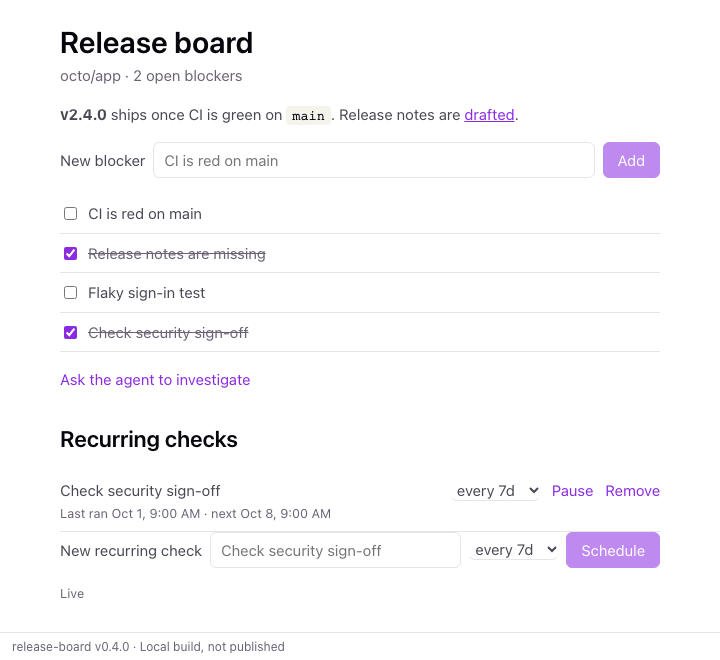

# Release board

<picture>
  <source media="(prefers-color-scheme: dark)" srcset="../../docs/release-board-dark.png">
  
</picture>

An example canvas built with [@rwoll/canvas-kit](../../packages/canvas-kit/README.md):
track release blockers for a repository together with the agent.

It shows open input (`{ "repo": "octo/app" }`), one saved board per repository,
actions for the agent only (`clear_resolved`) and the UI only (`ask_agent`), and
messaging the agent from the canvas.

```sh
pnpm --filter release-board dev     # UI with live canvas logic in a browser
pnpm --filter release-board test    # unit tests (Vitest)
pnpm --filter release-board build
pnpm --filter release-board e2e     # browser tests (Playwright) against the build
```
